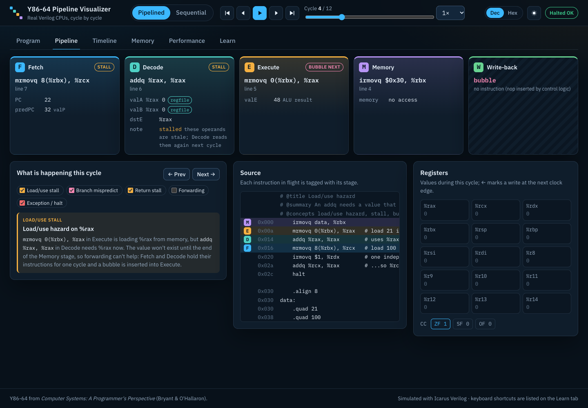
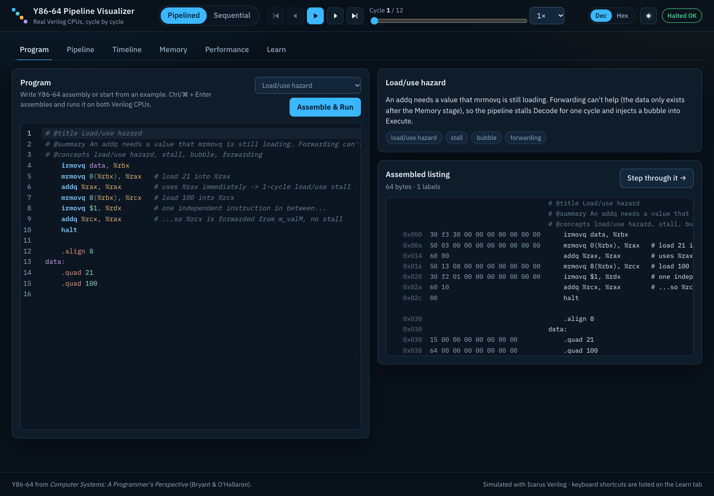
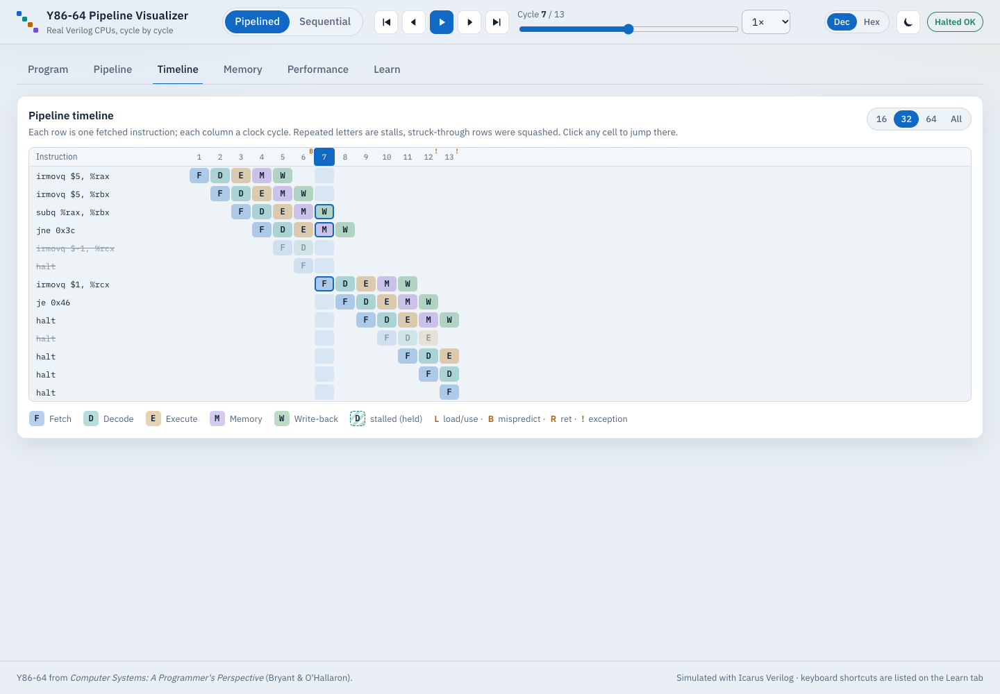
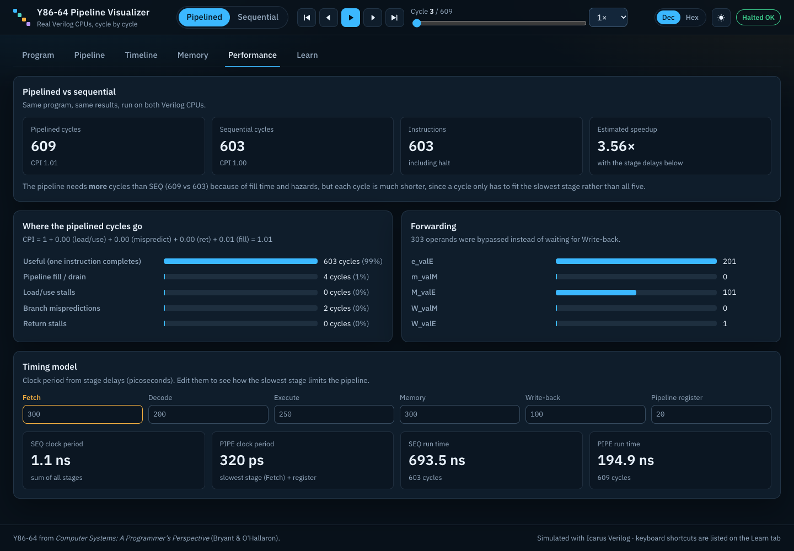
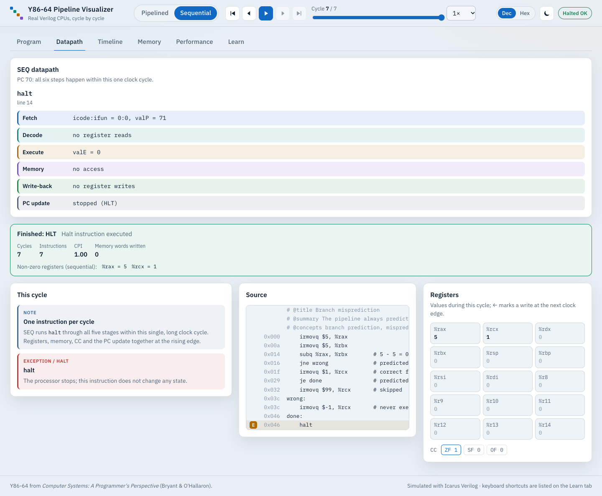
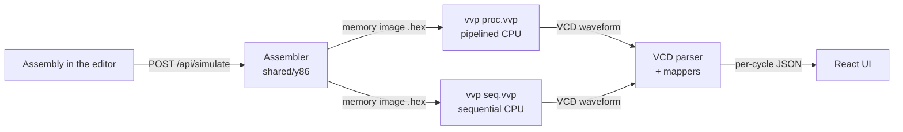

# Y86-64 Pipeline Visualizer

Write Y86-64 assembly in the browser, run it on **two real Verilog CPUs** (a 5-stage pipeline and a single-cycle sequential processor), and step through every clock cycle. The visualizer explains each stall, bubble, forward and misprediction in plain language.

> Y86-64 is the teaching ISA from *Computer Systems: A Programmer's Perspective* (Bryant & O'Hallaron). The pipelined CPU implements CS:APP's **PIPE** design, and the sequential CPU implements **SEQ**.



## Features

- **Write and run your own programs.** A CodeMirror editor with Y86 syntax highlighting and a `yas`-compatible assembler (labels, `.pos`, `.align`, `.quad`, `.byte`). Assembler errors are marked on the line where they occur. Ten example programs are included, each built to demonstrate one concept.
- **Real hardware, not a JS imitation.** Each run assembles your program, loads it into the Verilog CPUs under Icarus Verilog, and maps the resulting waveform back into per-cycle state.
- **Hazards explained.** For every cycle the visualizer says what is happening and why. The text is generated from the CPU's own control signals (`load_use`, `mispredict`, `ret_hazard`, forwarding selectors). Example:
  > *`mrmovq 0(%rbx), %rax` in Execute is loading %rax, but `addq %rax, %rax` in Decode needs it now… Fetch and Decode hold their instructions for one cycle and a bubble is inserted into Execute.*

  **Prev/Next** (or `[` / `]`) jumps between load/use stalls, mispredictions, ret stalls, forwards and exceptions.
- **Five stage cards.** Each shows the instruction in that stage, its computed values, and where each forwarded operand came from (`e_valE`, `m_valM`, …).
- **Pipeline timeline.** The classic staircase diagram across the whole run. Stalls show as held cells and squashed wrong-path instructions are struck through. Click any cell to jump to that cycle.
- **Memory.** The program bytes are shown with stage markers. Data memory shows labels, the `%rsp` pointer, and each word's last writer as the program runs.
- **Performance.** Compare pipelined vs sequential cycle counts, see a CPI breakdown (`1 + load/use + mispredict + ret + fill`) and forwarding statistics, and edit the stage delays in a timing model to see why the pipeline wins despite needing more cycles.
- **Learn tab.** What each instruction does in each stage (after CS:APP Figs. 4.18–4.21), a glossary, and keyboard shortcuts.
- **Interface.** Light and dark themes (following the OS by default), keyboard navigation, screen-reader labels, reduced-motion support, and a mobile layout.

| Program editor | Timeline (light theme) |
|---|---|
|  |  |
| **Performance** | **Sequential datapath** |
|  |  |

## Quick start

Prerequisites: **Node.js 20.19+** and **Icarus Verilog** (`iverilog`, `vvp`) plus `make`.

```bash
# macOS
brew install icarus-verilog
# Ubuntu / Debian
sudo apt-get install iverilog make
```

Then, from the repository root:

```bash
npm install      # installs root, backend and frontend dependencies
npm run dev      # API on :3001 + web app on :5173
```

Open <http://localhost:5173>. The first example is assembled and run automatically.

## How it works



1. **Assemble.** `shared/y86/assembler.js` produces a byte image, a listing, and a PC-to-source-line map.
2. **Simulate.** The backend writes the image to a temp directory and runs both precompiled CPUs: `vvp … +program=prog.hex +vcd=trace.vcd +memdump=mem.hex`. The CPUs stop when `halt` or an exception reaches Write-back, or at a cycle cap.
3. **Map.** A scope-aware VCD parser samples every signal just before each rising clock edge, which is the settled end-of-cycle state. The pipeline mapper follows each fetched instruction through the stages, marks bubbles, and exposes the hardware's hazard and forwarding signals.
4. **Explain.** The frontend turns those signals into explanations, the timeline, memory replays and metrics.

## Repository layout

```
hardware/
  common/        shared stage modules: fetch, decode, execute (gate-level CLA ALU),
                 mem_ctrl, regfile + pipeline registers, unified byte-addressed RAM
  pipeline/      proc.v: PIPE top level (pipeline registers, hazard control, forwarding)
  sequential/    seq.v: SEQ top level
  tb/            self-checking unit testbenches + smoke-test program
  Makefile       make / make test
shared/y86/      ISA tables, assembler, disassembler, reference simulator (ES modules)
programs/        example .ys programs (# @title / @summary / @concepts headers)
backend/         Express API: assemble, run vvp, parse VCD, map cycles
frontend/        React + Vite UI
tests/           cross-checks of both Verilog CPUs against the reference simulator
```

## ISA support

| Instruction | Encoding | Pipelined | Sequential |
|---|---|:-:|:-:|
| `halt`, `nop` | `00`, `10` | ✓ | ✓ |
| `rrmovq` / `cmovle` `cmovl` `cmove` `cmovne` `cmovge` `cmovg` | `2fn rA rB` | ✓ | ✓ |
| `irmovq V, rB` | `30 F rB V` | ✓ | ✓ |
| `rmmovq rA, D(rB)` / `mrmovq D(rB), rA` | `40`/`50 rA rB D` | ✓ | ✓ |
| `addq` `subq` `andq` `xorq` | `6fn rA rB` | ✓ | ✓ |
| `jmp` `jle` `jl` `je` `jne` `jge` `jg` | `7fn Dest` | ✓ | ✓ |
| `call Dest` / `ret` | `80 Dest` / `90` | ✓ | ✓ |
| `pushq rA` / `popq rA` | `A0 rA F` / `B0 rA F` | ✓ | ✓ |

- **Memory.** One unified, byte-addressed 8 KB memory for code and data. Words are 8-byte little-endian.
- **Status codes.** `AOK`, `HLT`, `ADR` (address outside memory) and `INS` (invalid icode or ifun).
- **Exceptions.** An instruction that raises an exception changes no state, and neither does anything after it.
- **Pipeline policy.** Branches are predicted taken. A load/use hazard costs 1 stall cycle, a misprediction costs 2 bubbles, and `ret` costs 3 bubbles. Forwarding comes from `e_valE`, `m_valM`, `M_valE`, `W_valM` and `W_valE`.

## Writing your own programs

Write in the editor, or add a file to `programs/`:

```asm
# @title My program
# @summary One sentence shown on the Program tab.
# @concepts forwarding, stack
    irmovq stack, %rsp
    irmovq $7, %rdi
    call square
    halt
square: ...
    .pos 0x200
stack:
```

Set up `%rsp` yourself before using the stack. Every register starts at 0.

## Tests

```bash
npm test          # everything below
npm run test:hw   # hardware only
```

| Suite | What it checks |
|---|---|
| `make -C hardware test` | Self-checking ALU (4,000 random vectors and edge cases), fetch, execute and RAM testbenches, plus a sum-of-1..100 smoke test on both CPUs |
| `node --test shared/test` | Assembler golden encodings, error reporting, disassembler round-trip, reference simulator results for every example |
| `node --test tests` | **Every example on both Verilog CPUs matches the reference simulator**: status, all registers, condition codes and every memory byte. Plus seeded fuzzing of the pipeline with random hazard-dense programs (`FUZZ_PROGRAMS=500 FUZZ_SEED=7` to go further) |
| `npm test --prefix backend` | VCD parser (64-bit precision, sampling), hazard expectations per example (exactly one load/use stall, 2-cycle mispredict, 3 ret bubbles…), HTTP API |
| `npm test --prefix frontend` | Hazard explanations, CPI decomposition, timeline and memory replay on fixtures from the real CPUs, plus an App smoke test |

To regenerate the frontend fixtures after changing the hardware, run `node frontend/scripts/gen-fixtures.mjs`.

## Running the hardware directly

```bash
make -C hardware                      # build/proc.vvp and build/seq.vvp
make -C hardware run CPU=proc PROGRAM=tb/sum_1_to_100.hex
gtkwave hardware/build/proc.vcd       # optional waveform viewer
```

Plusargs: `+program=<hex>`, `+vcd=<file>`, `+max_cycles=<n>` (default 2000), `+memdump=<file>`.

## Known limitations

- Programs run for at most 10,000 cycles (3,000 by default). The UI reports when a run hits the cap.
- Instruction text and source lines come from the assembled program image, so self-modifying code would be labelled with its original instructions.
- Local use only: there is no authentication or sandboxing beyond temp directories and time limits.

## License

GPL-3.0. See [LICENSE](LICENSE).
